<p align="center">
  
</p>

<p align="center">
  
</p>

<p align="center">
  <a href="https://github.com/Khuddush89/Physics-Informed-Neural-Networks-for-ODEs/actions/workflows/tests.yml"></a>
  
  
  
  
  
  <a href="LICENSE"></a>
</p>

Companion code for the book

> **S. G. Georgiev, M. Khuddush, P. Agarwal.**
> *Physics-Informed Neural Networks for Ordinary, Integral and Integro-Differential Equations:
> Theory, Algorithms and Python Implementations.* CRC Press (forthcoming).

Every figure, table and number in the book is produced by a script in this repository, in
**double precision**, with a **fixed seed**, on an ordinary **CPU**.


## 

The book develops physics-informed neural networks (PINNs) for **ordinary differential
equations, integral equations and integro-differential equations** in one notation, and is
candid about what they can and cannot do:

* **Theory** - formulation and loss design, approximation and optimization, and error bounds
  that turn a small residual into a guaranteed small error (Gronwall, Green's functions,
  resolvents).
* **Practice** - initial, boundary and terminal value problems; adjoint and forward-backward
  (optimal control) systems; Fredholm, Volterra and oscillatory integral equations;
  Volterra, Fredholm and convolution integro-differential equations.
* **Honesty** - a chapter on failure modes (spectral bias, loss imbalance, stiffness,
  causality, chaos) and their remedies, and a chapter of **work-precision benchmarks against
  Runge-Kutta, BDF, collocation, shooting and Nystrom methods**.
* **Where PINNs shine** - inverse problems, data assimilation and uncertainty quantification;
  plus singular, delay, fractional, differential-algebraic, eigenvalue and time-scale problems.


## 

Real training runs, recorded snapshot by snapshot (`scripts/make_animations.py`).

<table>
<tr>
<td align="center" width="50%">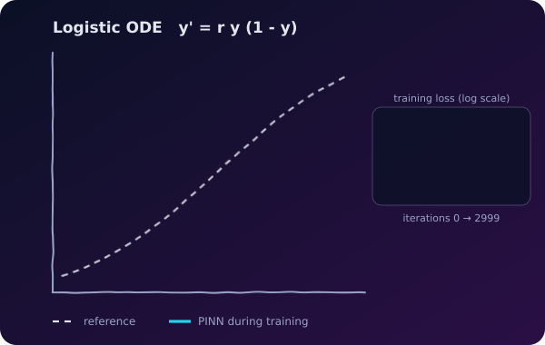<br><sub>Logistic ODE: the PINN curve morphs onto the exact solution while the loss drops.</sub></td>
<td align="center" width="50%">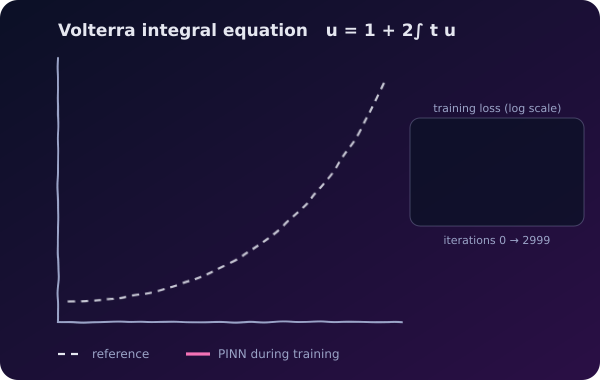<br><sub>Volterra integral equation with a quadrature residual.</sub></td>
</tr>
<tr>
<td align="center">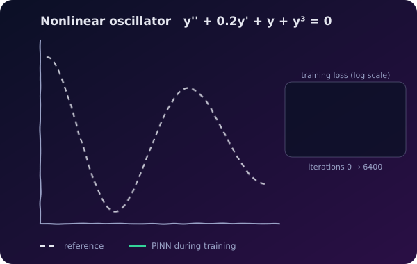<br><sub>Nonlinear damped oscillator with hard initial conditions.</sub></td>
<td align="center">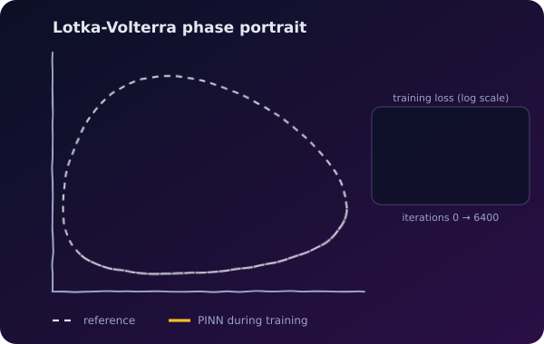<br><sub>Lotka-Volterra phase portrait (log-variables keep populations positive).</sub></td>
</tr>
<tr>
<td align="center">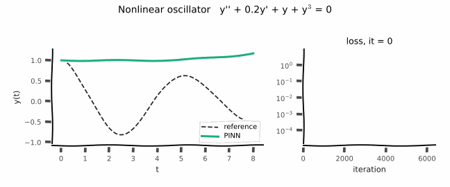<br><sub>Sketch-style replay: solution (left) and loss (right).</sub></td>
<td align="center">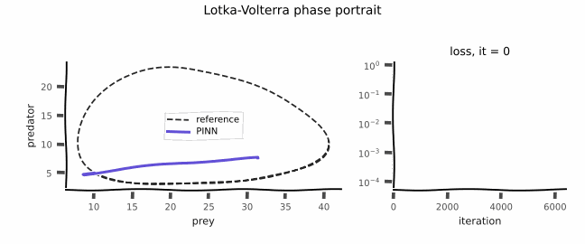<br><sub>Sketch-style replay of the predator-prey cycle being learned.</sub></td>
</tr>
</table>


## 

| Ch. | Topic | What you will find | Code | Notebook |
|:--:|---|---|---|---|
| **1** | **Formulation and loss design** | history and prior work, when PINNs are worthwhile, one notation for IVP/BVP/TVP/IE/IDE, soft vs hard conditions, related methods (Neural ODEs, HNN, SINDy, DeepONet, ELM, TFC, KAN) | [`ch01_formulation/`](chapters/ch01_formulation) | [`ch01_first_pinn_assignment.ipynb`](notebooks/ch01_first_pinn_assignment.ipynb) |
| **2** | **Approximation, optimization and error analysis** | activations used in the book, universal approximation with derivatives, Adam and L-BFGS, Gronwall / Green / resolvent bounds turning residuals into certified errors | [`ch02_theory/`](chapters/ch02_theory) | [`ch02_error_bounds_assignment.ipynb`](notebooks/ch02_error_bounds_assignment.ipynb) |
| **3** | **Architectures and exact enforcement of conditions** | MLP, Chebyshev and Legendre networks, Fourier features, SIREN, A-PINN auxiliary outputs, trial functions for Dirichlet/Neumann/Robin/terminal conditions, TFC | [`ch03_architectures/`](chapters/ch03_architectures) | [`ch03_architectures_assignment.ipynb`](notebooks/ch03_architectures_assignment.ipynb) |
| **4** | **Initial value problems** | hand-checked single-point calculation, logistic activation study (soft vs hard IC), van der Pol, Lotka-Volterra, third-order system, cost vs RK45 | [`ch04_ivp/`](chapters/ch04_ivp) | [`ch04_ivp_assignment.ipynb`](notebooks/ch04_ivp_assignment.ipynb) |
| **5** | **Boundary value problems** | Duffing-type BVP with infinitely many solutions, Chebyshev PINNs, collocation/shooting/FD comparison, boundary layers, a BVP without solution | [`ch05_bvp/`](chapters/ch05_bvp) | [`ch05_bvp_assignment.ipynb`](notebooks/ch05_bvp_assignment.ipynb) |
| **6** | **Terminal value problems, adjoint and forward-backward systems** | time reversal and backward conditioning, terminal trial functions, adjoint sensitivities, LQR Riccati TVP, Hamiltonian forward-backward system, optimal growth | [`ch06_tvp/`](chapters/ch06_tvp) | [`ch06_tvp_assignment.ipynb`](notebooks/ch06_tvp_assignment.ipynb) |
| **7** | **Integral equations** | Fredholm (degenerate kernel), Volterra (A-PINN and quadrature), Helmholtz-type oscillatory kernel with Filon panels, Nystrom comparison | [`ch07_integral_equations/`](chapters/ch07_integral_equations) | [`ch07_integral_equations_assignment.ipynb`](notebooks/ch07_integral_equations_assignment.ipynb) |
| **8** | **Integro-differential equations** | Volterra IDE (quadrature vs A-PINN, rapid growth), Fredholm IDE, convolution kernels via internal variables, delay IDE | [`ch08_integro_differential/`](chapters/ch08_integro_differential) | [`ch08_ide_assignment.ipynb`](notebooks/ch08_ide_assignment.ipynb) |
| **9** | **Training difficulties, diagnostics and remedies** | spectral bias, loss imbalance, trivial solutions, stiffness, causality and long horizons, chaos (Lorenz), optimizers, a troubleshooting checklist | [`ch09_training_diagnostics/`](chapters/ch09_training_diagnostics) | [`ch09_training_diagnostics_assignment.ipynb`](notebooks/ch09_training_diagnostics_assignment.ipynb) |
| **10** | **Benchmarking against classical solvers** | work-precision diagrams vs RK45/DOP853/Radau/BDF/LSODA, collocation, shooting, finite differences, Nystrom; parametric break-even; residual certificates | [`ch10_benchmarking/`](chapters/ch10_benchmarking) | [`ch10_benchmarking_assignment.ipynb`](notebooks/ch10_benchmarking_assignment.ipynb) |
| **11** | **Inverse problems, data assimilation and UQ** | parameter and source identification, partially observed Lotka-Volterra, Volterra parameter identification, ensembles vs Gauss-Newton vs Metropolis | [`ch11_inverse_problems/`](chapters/ch11_inverse_problems) | [`ch11_inverse_assignment.ipynb`](notebooks/ch11_inverse_assignment.ipynb) |
| **12** | **Further equation classes** | stiff Robertson kinetics, Lane-Emden, delay, fractional (Caputo/L1), DAE, Sturm-Liouville eigenproblems, dynamic equations on time scales | [`ch12_further_classes/`](chapters/ch12_further_classes) | [`ch12_time_scales_assignment.ipynb`](notebooks/ch12_time_scales_assignment.ipynb) |

Each chapter folder has a `README.md` mapping every script to the section, figure and table it produces, with its runtime.


## 

One figure per chapter, exactly as printed in the book (all regenerated by the scripts in
`chapters/`; vector PDFs in `outputs/` after a run).

<table>
<tr>
<td align="center" width="33%">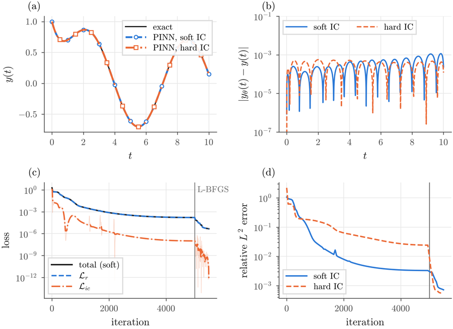<br><sub><b>Ch. 1</b> First PINN: soft vs hard initial condition</sub></td>
<td align="center" width="33%">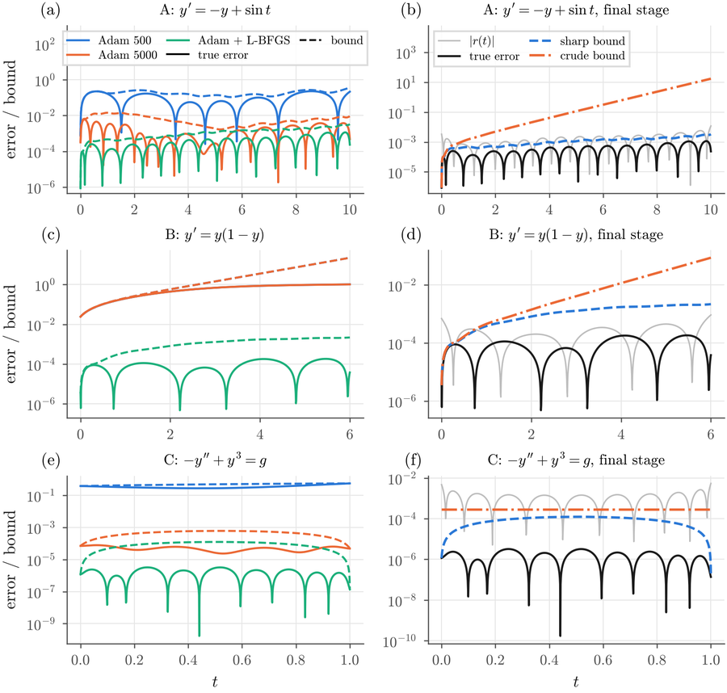<br><sub><b>Ch. 2</b> Certified a posteriori error bounds</sub></td>
<td align="center" width="33%">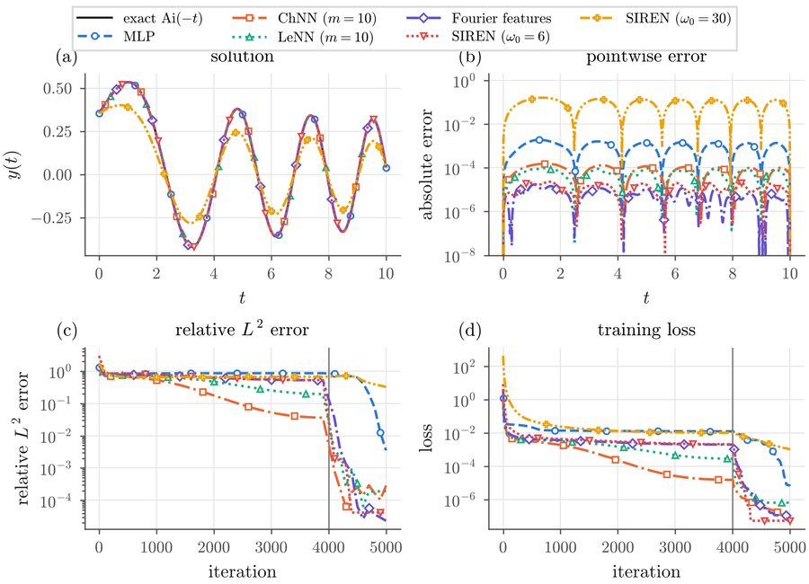<br><sub><b>Ch. 3</b> Architectures on the Airy problem</sub></td>
</tr>
<tr>
<td align="center" width="33%">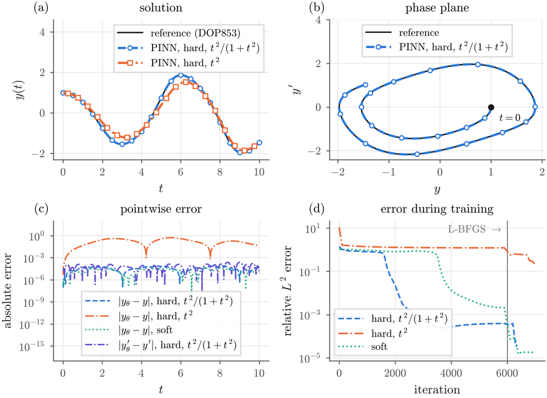<br><sub><b>Ch. 4</b> van der Pol: hard vs soft initial conditions</sub></td>
<td align="center" width="33%">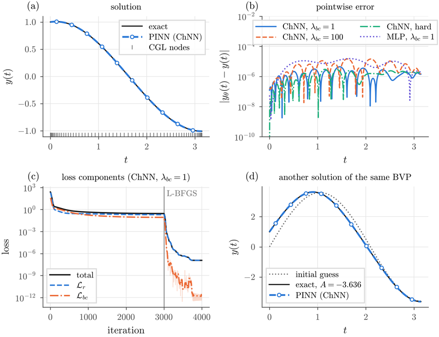<br><sub><b>Ch. 5</b> Duffing BVP with two solutions</sub></td>
<td align="center" width="33%">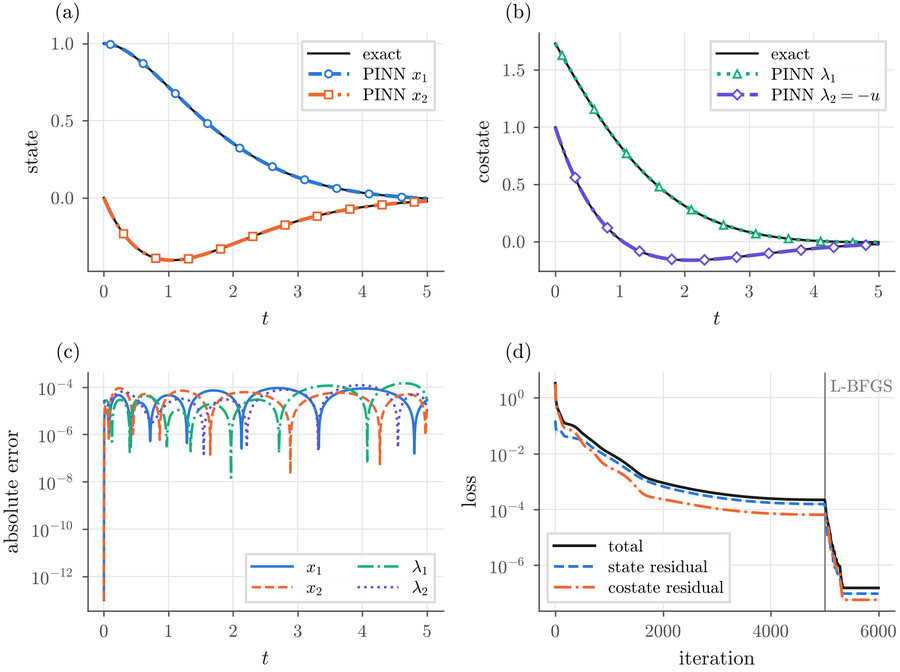<br><sub><b>Ch. 6</b> LQR forward-backward system, one PINN</sub></td>
</tr>
<tr>
<td align="center" width="33%">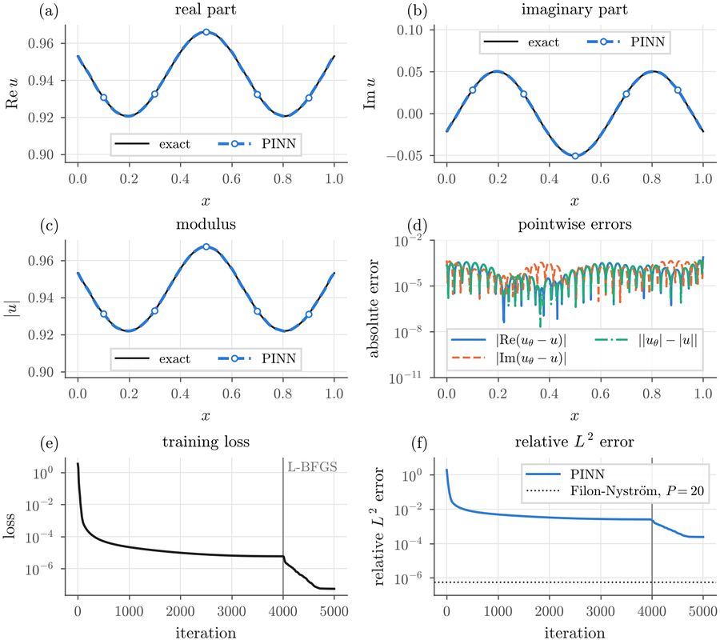<br><sub><b>Ch. 7</b> Oscillatory Helmholtz-type integral equation</sub></td>
<td align="center" width="33%">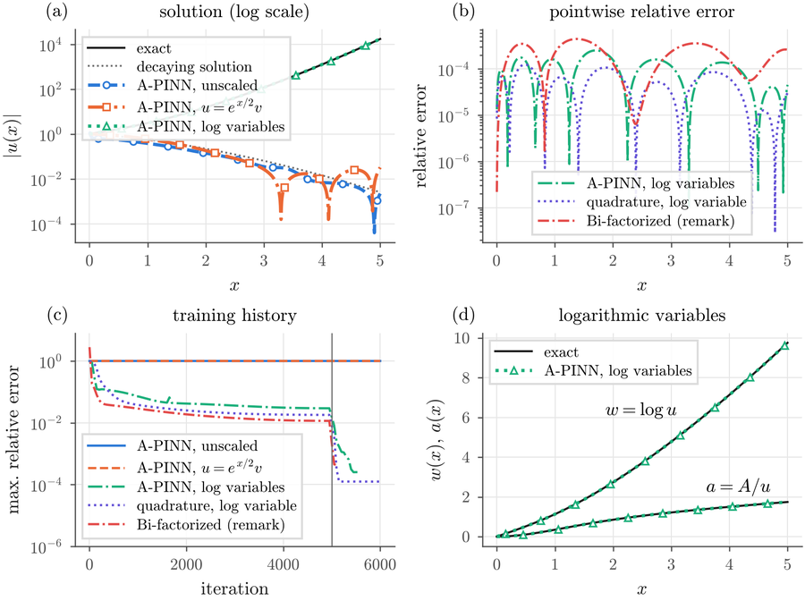<br><sub><b>Ch. 8</b> Volterra IDE with rapid growth</sub></td>
<td align="center" width="33%">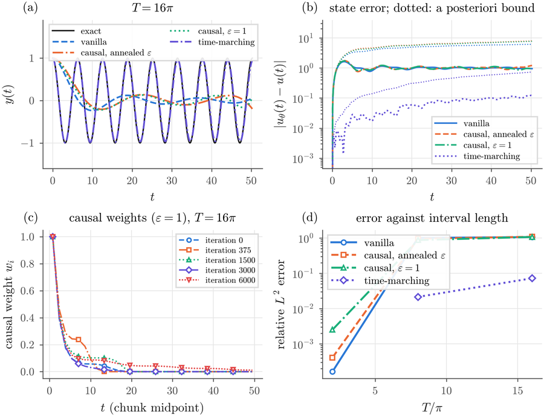<br><sub><b>Ch. 9</b> Long horizons: causal weights vs time-marching</sub></td>
</tr>
<tr>
<td align="center" width="33%">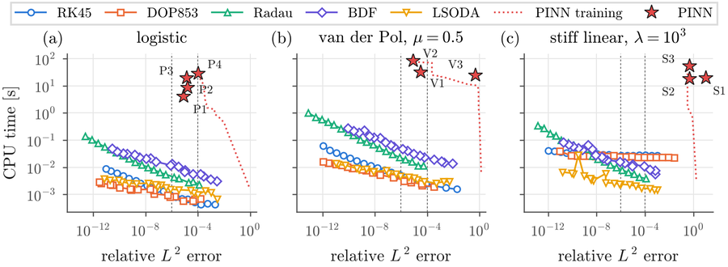<br><sub><b>Ch. 10</b> Work-precision vs RK45/DOP853/Radau/BDF</sub></td>
<td align="center" width="33%">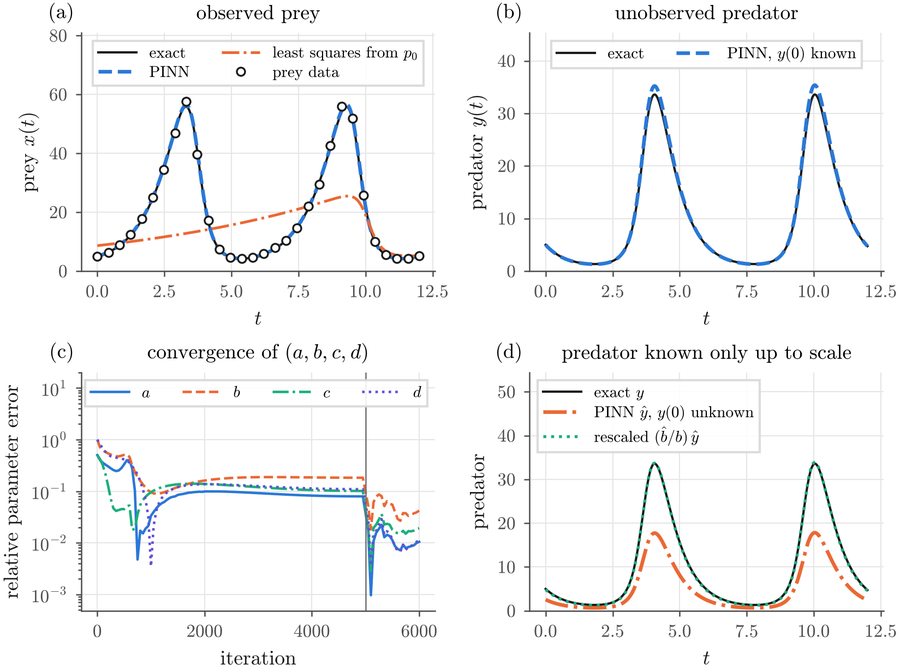<br><sub><b>Ch. 11</b> Inverse problem: prey-only observations</sub></td>
<td align="center" width="33%">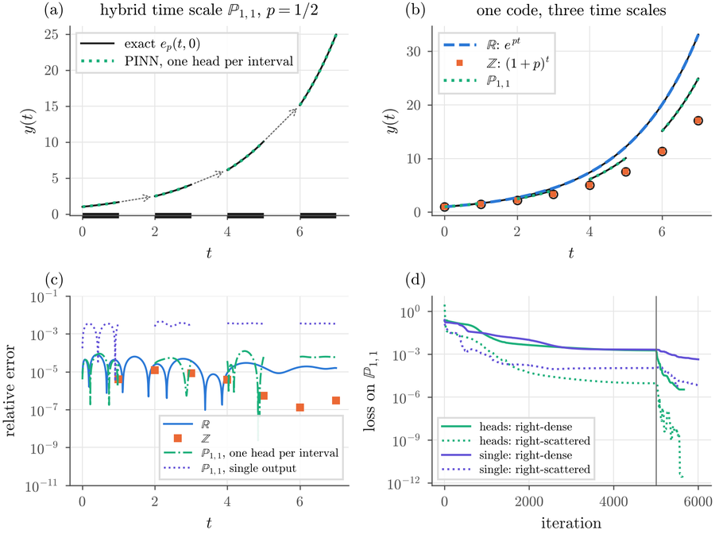<br><sub><b>Ch. 12</b> Dynamic equations on time scales</sub></td>
</tr>
</table>


## 

```bash
git clone https://github.com/Khuddush89/Physics-Informed-Neural-Networks-for-ODEs.git
cd Physics-Informed-Neural-Networks-for-ODEs
python -m venv .venv && source .venv/bin/activate        # Windows: .venv\Scripts\activate
pip install torch --index-url https://download.pytorch.org/whl/cpu   # CPU build is enough
pip install -r requirements.txt                           # or requirements-lock.txt (exact versions)

PYTHONPATH=. python chapters/ch04_ivp/logistic_activation_study.py   # one example (~2 min)
python scripts/run_all.py --quick                         # smoke-test every script
python scripts/run_all.py --chapter ch07                  # reproduce one chapter
pytest -q                                                 # the test suite used in CI
```

Results appear in `outputs/<chapter>/<example>/` (`results.json`, CSV histories, PDF/PNG figures).


## 

All examples share a small library, so each script contains only the mathematics of its problem.

```python
import numpy as np
from pinnode import Example, MLP, ConstrainedModel, derivative, to_tensor, train

ex = Example("ch04_ivp", "logistic_minimal", default_seed=1234)   # seed, float64, outputs
r, y0, T = 2.0, 0.1, 2.0
model = ConstrainedModel(MLP(1, 1, width=32, depth=3, domain=(0, T)),
                         lambda t, n: y0 + t * n)                  # y(0) = y0 exactly
t = to_tensor(np.linspace(0, T, 100), requires_grad=True)          # collocation points

def loss_fn():
    y = model(t)
    res = derivative(y, t) - r * y * (1 - y)                      # ODE residual
    return (res**2).mean(), {"residual": (res**2).mean()}

hist = train(model.parameters(), loss_fn, adam_iters=8000, lr=1e-3, lbfgs_iters=500)
```

| module | contents |
|--------|----------|
| `pinnode.networks` | `MLP` (input scaling), `ChebyshevNet`, `LegendreNet`, `FourierFeatureNet`, `SirenNet`, `ConstrainedModel` (hard constraints) |
| `pinnode.autodiff` | derivatives of any order of each output |
| `pinnode.quadrature` | Chebyshev/Legendre nodes, (composite) Gauss-Legendre, trapezoid, Volterra nodes on [a, x] |
| `pinnode.training` | Adam (cosine schedule) -> L-BFGS (strong Wolfe), full loss/metric histories |
| `pinnode.reference` | `solve_ivp`/`solve_bvp` references, Nystrom, trapezoidal product integration |
| `pinnode.plotting` | the book's figure style (color-blind-safe, grayscale-safe, vector PDF) |
| `pinnode.utils` | `Example`: CLI (`--quick`, `--seed`), seeding, outputs, versions in `results.json` |


## 

* **Pinned environment**: `requirements-lock.txt` lists the exact versions used for the book
  (PyTorch 2.15.0, NumPy 2.5.3, SciPy 1.18.1, Matplotlib 3.11.2); `requirements.txt` gives
  minimum versions.
* **Determinism**: fixed default seed per script (printed and stored in `results.json`),
  deterministic kernels, one CPU thread, `float64`.
* **Runtime notes**: every script reports its training time; the full table is in
  Appendix B of the book and in `outputs/summary.csv` after `scripts/run_all.py`.
* **Tested**: `pytest` runs every script in `--quick` mode; GitHub Actions runs the suite on
  every push.
* **Archived**: releases are archived on Zenodo (`.zenodo.json`) for a persistent DOI.

See [`docs/REPRODUCIBILITY.md`](docs/REPRODUCIBILITY.md) for the expected level of agreement
across machines.


## 

```text
pinnode/            shared library
chapters/           one folder per book chapter (scripts + README with figure/table mapping)
notebooks/          assignment notebooks (one per chapter)
scripts/            run_all.py, README artwork generators
tests/              smoke tests (every script, --quick)
docs/               reproducibility notes
assets/             animated banner, headings and motion gallery
outputs/            created by the scripts (git-ignored)
```


## 

Each chapter of the book ends with exercises (selected solutions in Appendix C) and a
**notebook assignment** in [`notebooks/`](notebooks): a short recap, tasks with `# TODO`
skeleton code built on `pinnode`, and "check your answer" cells. The notebooks run on a CPU
in minutes and are suitable for lab sessions.


## 

```bibtex
@book{GeorgievKhuddushAgarwal_PINNs,
  author    = {Georgiev, Svetlin G. and Khuddush, Mahammad and Agarwal, Praveen},
  title     = {Physics-Informed Neural Networks for Ordinary, Integral and
               Integro-Differential Equations: Theory, Algorithms and Python Implementations},
  publisher = {CRC Press},
  note      = {Companion code: https://github.com/Khuddush89/Physics-Informed-Neural-Networks-for-ODEs}
}
```

GitHub's "Cite this repository" button uses [`CITATION.cff`](CITATION.cff).

## 

Code released under the [MIT license](LICENSE). Errata and improvements are welcome - see
[`CONTRIBUTING.md`](CONTRIBUTING.md) and [`CHANGELOG.md`](CHANGELOG.md).

<p align="center"></p>
